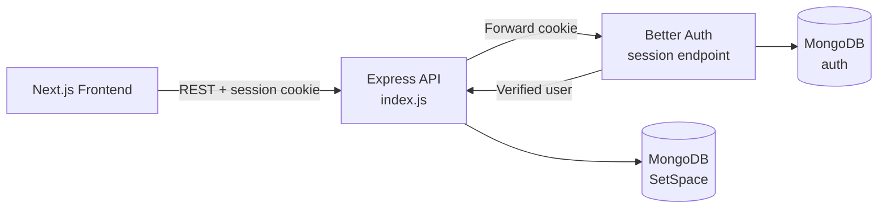
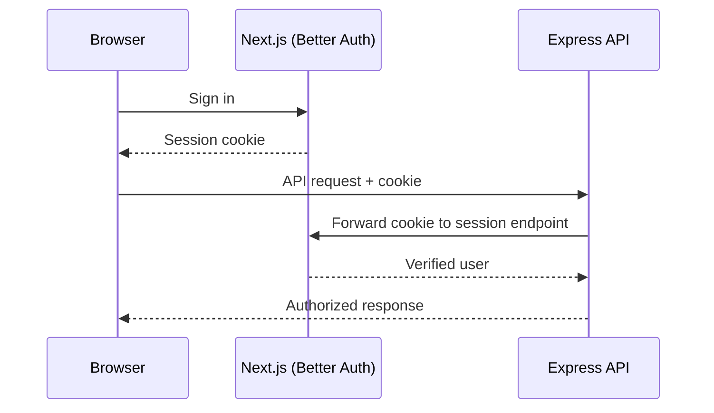

<div align="center">

# ⚙️ SetSpace Backend API

### Powering the SetSpace Creative Studio Rental Marketplace

**Discover. Book. Create.**

A RESTful API built with Node.js, Express.js, and MongoDB that manages studio listings, bookings, profiles, reviews, wishlists, notifications, and dashboards.

[](https://set-space-backend.vercel.app/)
[](https://set-space-ten.vercel.app/)
[](https://github.com/mehrabislam00/Set-Space)

</div>

---

## 📑 Table of Contents

- [Overview](#-overview)
- [Features](#-features)
- [Tech Stack](#-tech-stack)
- [Project Structure](#-project-structure)
- [Database](#-database)
- [Authentication](#-authentication--authorization)
- [API Reference](#-api-reference)
- [Response Format](#-response-format)
- [Getting Started](#-getting-started)
- [Environment Variables](#-environment-variables)
- [Deployment](#-deployment)
- [Notes & Limitations](#-notes--limitations)
- [Related Projects](#-related-projects)
- [License](#-license)

---

## 🌟 Overview

The SetSpace Backend sits between the Next.js frontend and MongoDB. It ensures protected operations are performed only by authenticated and authorized users, and uses **Better Auth** for session-based authentication.

> [!NOTE]
> The backend currently follows a **single-file architecture**: all server-side code lives in `index.js`.

| Resource | Link |
| --- | --- |
| 🌐 Live Website | [set-space-ten.vercel.app](https://set-space-ten.vercel.app/) |
| 🔌 Live Backend API | [set-space-backend.vercel.app](https://set-space-backend.vercel.app/) |
| 💻 Frontend Repo | [mehrabislam00/Set-Space](https://github.com/mehrabislam00/Set-Space) |
| ⚙️ Backend Repo | [mehrabislam00/set-space-backend](https://github.com/mehrabislam00/set-space-backend) |



## ✨ Features

<details open>
<summary><b>🏢 Studio Management</b></summary>

- Retrieve published listings and individual studio details
- Create, update, and delete studios
- Save as draft or publish
- Manage photographs, weekly opening hours, and unavailable dates
- Retrieve host contact information (with authorization)

</details>

<details open>
<summary><b>📅 Booking Management</b></summary>

- Create booking requests with date and time-slot validation
- Prevent conflicting bookings
- Retrieve renter and host bookings
- Manage status transitions: `pending`, `confirmed`, `rejected`, `completed`, `cancelled`
- Calculate booking totals and service fees

</details>

<details>
<summary><b>👤 Profiles</b></summary>

- Retrieve, create, and update profiles
- Update and retrieve profile images
- Clear editable profile fields
- Account information and profile statistics

</details>

<details>
<summary><b>⭐ Reviews & Ratings</b></summary>

- Retrieve studio reviews
- Check review eligibility
- Submit reviews after eligible completed bookings
- Update studio ratings and review counts
- Prevent duplicate reviews for the same booking

</details>

<details>
<summary><b>❤️ Wishlists & 🔔 Notifications</b></summary>

- Save, list, and remove wishlist studios (per user)
- List notifications, mark one or all as read, and delete

</details>

<details>
<summary><b>📊 Dashboard Statistics</b></summary>

For both renter and host dashboards: total and upcoming bookings, studio listings, pending requests, earnings, monthly earnings, and wishlist stats.

</details>

<details>
<summary><b>🧰 Additional Services</b></summary>

- Contact form message storage
- Newsletter subscription management
- Automatic collection and index initialization
- Database connectivity (health) checks

</details>

## 🧰 Tech Stack

| Technology | Purpose |
| --- | --- |
| **Node.js** | JavaScript runtime |
| **Express.js 5** | Backend framework |
| **MongoDB** + Node.js Driver | Database and operations |
| **Better Auth** | Authentication and session verification |
| **CORS** | Cross-origin request handling |
| **dotenv** | Environment configuration |
| **@xmldom/xmldom** | XML parsing and serialization |
| **Vercel** | Deployment |

## 📂 Project Structure

```text
set-space-backend/
├── index.js            # Express server, middleware, DB init, auth helpers, routes
├── package.json        # Dependencies and scripts
├── package-lock.json   # Locked dependency versions
├── vercel.json         # Vercel deployment configuration
└── README.md
```

`index.js` contains the Express config, environment handling, CORS, request parsing, MongoDB connection and initialization, authentication and authorization helpers, index management, all route handlers, and error handling.

## 🗄 Database

One MongoDB cluster, two databases:

| Database | Responsibility |
| --- | --- |
| `auth` | Better Auth users, sessions, accounts, verification records |
| `SetSpace` | Marketplace application data |

**`SetSpace` collections**

| Collection | Description |
| --- | --- |
| `userProfiles` | User profile information |
| `studios` | Studio listings and details |
| `bookings` | Booking records |
| `reviews` | Studio reviews and ratings |
| `wishlists` | Saved studios |
| `notifications` | User notifications |
| `contactMessages` | Contact form submissions |
| `newsletterSubscribers` | Newsletter subscriptions |

Better Auth manages its own collections in the lowercase `auth` database. The backend reads the necessary user records but **never modifies** Better Auth's data. Application collections and indexes are created automatically on connect.

## 🔐 Authentication & Authorization

Authentication is handled by the Next.js frontend. The Express backend independently verifies session cookies before allowing protected operations.



**Security considerations**

- Protected endpoints require a valid session
- User identity comes from the verified session, never from request-body user IDs
- Studio ownership is validated before host-specific changes
- Booking, profile, and wishlist operations are user-specific
- CORS restricts requests to configured frontend origins
- Request data is validated before database operations

## 📚 API Reference

**Base URL**

| Environment | URL |
| --- | --- |
| Production | `https://set-space-backend.vercel.app` |
| Local | `http://localhost:5000` |

### Service & Public

| Method | Endpoint | Description | Access |
| --- | --- | --- | --- |
| `GET` | `/` | Check API availability | Public |
| `GET` | `/api/health` | Check database health | Public |
| `GET` | `/api/studios` | List published studios | Public |
| `GET` | `/api/studios/:id` | Studio details | Public |
| `GET` | `/api/studios/:id/photos/:index` | Studio photograph | Conditional |
| `GET` | `/api/reviews?studioId=:id` | Studio reviews | Public |
| `POST` | `/api/contact` | Submit contact message | Public |
| `POST` | `/api/newsletter` | Subscribe to newsletter | Public |

### Studios 🔒

*Require authentication and enforce ownership where applicable.*

| Method | Endpoint | Description |
| --- | --- | --- |
| `GET` | `/api/studios/mine` | List host-owned studios |
| `GET` | `/api/studios/mine/:id` | Get an owned studio |
| `POST` | `/api/studios` | Create a studio |
| `PATCH` | `/api/studios/:id` | Update a studio |
| `PATCH` | `/api/studios/:id/status` | Update publication status |
| `DELETE` | `/api/studios/:id` | Delete a studio |
| `GET` | `/api/studios/:id/contact` | Get host contact details |

### Bookings 🔒

| Method | Endpoint | Description |
| --- | --- | --- |
| `GET` | `/api/bookings?role=renter` | Renter bookings |
| `GET` | `/api/bookings?role=host` | Host bookings |
| `POST` | `/api/bookings` | Create a booking request |
| `PATCH` | `/api/bookings/:id/status` | Update booking status |

<details>
<summary>Example: create a booking</summary>

```json
{
  "studioId": "STUDIO_OBJECT_ID",
  "bookingDate": "2026-12-01",
  "startTime": "10:00",
  "endTime": "13:00",
  "guests": 2
}
```

The renter is determined from the verified session. The backend validates availability and conflicts.

</details>

### Reviews 🔒

| Method | Endpoint | Description |
| --- | --- | --- |
| `GET` | `/api/reviews` | Retrieve reviews |
| `GET` | `/api/reviews/eligibility?studioId=:id` | Check review eligibility |
| `POST` | `/api/reviews` | Submit a review (requires eligible completed booking) |

### Wishlists 🔒

| Method | Endpoint | Description |
| --- | --- | --- |
| `GET` | `/api/wishlists` | List saved studios |
| `POST` | `/api/wishlists` | Add a studio |
| `DELETE` | `/api/wishlists/:studioId` | Remove a studio |

### Notifications 🔒

| Method | Endpoint | Description |
| --- | --- | --- |
| `GET` | `/api/notifications` | List notifications |
| `PATCH` | `/api/notifications/read-all` | Mark all as read |
| `PATCH` | `/api/notifications/:id/read` | Mark one as read |
| `DELETE` | `/api/notifications/:id` | Delete a notification |

### Profile & Users 🔒

| Method | Endpoint | Description |
| --- | --- | --- |
| `GET` | `/api/profile` | Get profile and statistics |
| `POST` | `/api/profile` | Create profile |
| `PATCH` / `PUT` | `/api/profile` | Update profile |
| `DELETE` | `/api/profile` | Delete application profile |
| `DELETE` | `/api/profile/fields/:field` | Clear an editable field |
| `GET` | `/api/profile/image` | Get profile image |
| `PUT` | `/api/profile/image` | Upload or update profile image |
| `GET` | `/users/:id` | Get authenticated user account |
| `GET` | `/users/me` | Get current user |

> [!NOTE]
> Profile image uploads send **raw image data**, not a JSON body.

## 📨 Response Format

Most marketplace endpoints share one JSON structure:

```json
// Success
{
  "success": true,
  "message": "Request completed successfully",
  "data": {}
}

// Error
{
  "success": false,
  "message": "Something went wrong"
}
```

Profile endpoints use their own dedicated response and error formats.

## ⚡ Getting Started

### Prerequisites

- Node.js and npm
- Git
- A MongoDB Atlas account
- Access to the SetSpace frontend authentication service

### Setup

```bash
git clone https://github.com/mehrabislam00/set-space-backend.git
cd set-space-backend
npm install
```

Create a `.env` file (see below), then:

```bash
npm run dev
```

The server runs in Node.js watch mode at **http://localhost:5000**.

### Verify

| Check | URL |
| --- | --- |
| Service response | `http://localhost:5000/` |
| Database connectivity | `http://localhost:5000/api/health` |

### Scripts

| Command | Description |
| --- | --- |
| `npm run dev` | Start with Node.js watch mode |
| `node index.js` | Run the server directly |

## 🔑 Environment Variables

| Variable | Required | Description |
| --- | :---: | --- |
| `PORT` | ➖ | Server port (e.g. `5000`) |
| `MONGODB_URI` | ✅* | Full MongoDB connection string |
| `MONGODB_USERNAME` | ✅* | MongoDB username |
| `MONGODB_PASSWORD` | ✅* | MongoDB password |
| `AUTH_DB_NAME` | ✅ | Better Auth database name (`auth`) |
| `SETSPACE_DB_NAME` | ✅ | Application database name (`SetSpace`) |
| `CLIENT_URI` | ✅ | Comma-separated allowed frontend origins |
| `BETTER_AUTH_URL` | ✅ | Frontend URL hosting Better Auth |
| `AUTH_JWKS_URL` | ➖ | Optional Better Auth JWKS URL fallback |

\* Provide either `MONGODB_URI`, **or** both `MONGODB_USERNAME` and `MONGODB_PASSWORD`. If both are provided, the credential pair takes priority.

```env
PORT=5000

# Either this...
MONGODB_URI=your_mongodb_connection_string
# ...or this pair
# MONGODB_USERNAME=your_mongodb_username
# MONGODB_PASSWORD=your_mongodb_password

AUTH_DB_NAME=auth
SETSPACE_DB_NAME=SetSpace

CLIENT_URI=http://localhost:3000,https://set-space-ten.vercel.app
BETTER_AUTH_URL=http://localhost:3000
AUTH_JWKS_URL=http://localhost:3000/api/auth/jwks
```

> [!IMPORTANT]
> - Keep `AUTH_DB_NAME` as `auth` unless you also update the frontend's Better Auth configuration.
> - Set `CLIENT_URI` to the **exact** frontend origins you want to allow.
> - Replace localhost URLs with deployed URLs in production.
> - **Never commit `.env`** to GitHub.

## ☁️ Deployment

Deployed on **Vercel** at [set-space-backend.vercel.app](https://set-space-backend.vercel.app/).

1. Import the backend repository into Vercel.
2. Add the MongoDB credentials as environment variables.
3. Set `AUTH_DB_NAME=auth` and `SETSPACE_DB_NAME=SetSpace`.
4. Set `CLIENT_URI` to the production frontend origin.
5. Set `BETTER_AUTH_URL` to the production frontend URL.
6. Make sure MongoDB Atlas allows connections from the deployed backend.
7. Deploy and verify `/api/health`.

> [!IMPORTANT]
> Frontend and backend must use a compatible Better Auth configuration and the same authentication database. The frontend's `NEXT_PUBLIC_API_URL` must point to this deployed API.

## 📌 Notes & Limitations

- Single-file architecture (`index.js`)
- Booking requests and status management are implemented
- Online payment gateway integration is **not** included
- Better Auth authentication is managed by the frontend
- Automated test coverage is not yet configured

## 🔗 Related Projects

| Project | Link |
| --- | --- |
| SetSpace Frontend | [GitHub](https://github.com/mehrabislam00/Set-Space) |
| SetSpace Backend | [GitHub](https://github.com/mehrabislam00/set-space-backend) |
| Live Application | [set-space-ten.vercel.app](https://set-space-ten.vercel.app/) |
| Live Backend API | [set-space-backend.vercel.app](https://set-space-backend.vercel.app/) |

## 📄 License

Distributed under the **ISC License**, as declared in `package.json`.

---

<div align="center">

**SetSpace — Create. Rent. Inspire.**

Built to connect creative people with creative spaces.

</div>
